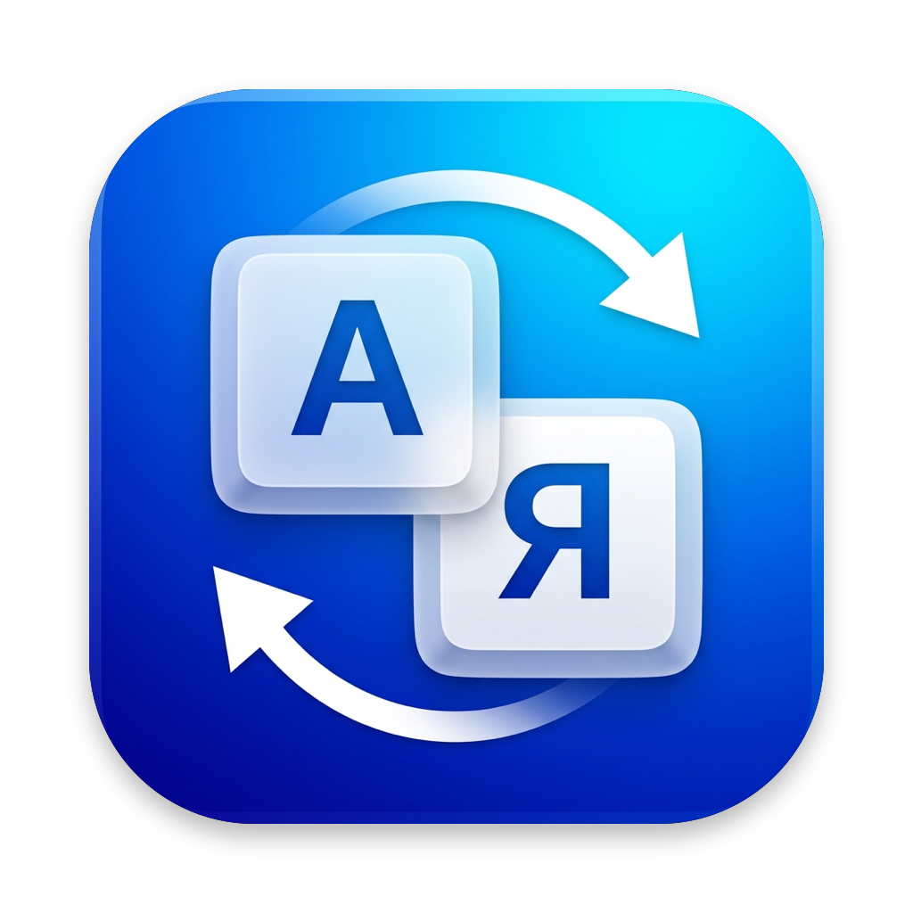

<p align="center">
  
</p>

<h1 align="center">SwiftSwitch</h1>

<p align="center">
  <strong>Ультралёгкий нативный (Apple Silicon) автопереключатель раскладки RU ↔ EN для macOS</strong><br/>
  <em>Ultra-lightweight native Apple Silicon RU ↔ EN keyboard layout auto-switcher for macOS</em>
</p>

<p align="center">
  
  
  
  
</p>

---

## Зачем SwiftSwitch?

Старый PuntoSwitcher работает на Mac с Apple Silicon (M1/M2/M3/M4) через эмулятор Rosetta 2 (`x86_64`) и постоянно нагружает процессор.

**SwiftSwitch** написан на чистом **Swift** с использованием системных фреймворков macOS (`Carbon` / `TIS`, `NSSpellChecker`, `CGEventTap`):
- **0.0% CPU** в простое, **~25–30 МБ ОЗУ**, размер приложения **~300 КБ**.
- **Нативный Apple Silicon (`arm64`)** — без Electron, без Rosetta 2, без сторонних зависимостей.
- **Автопереключение `RU ↔ EN`** по `Пробел` / `Enter` на базе встроенных словарей macOS (`ltkfq` → `делай`, `ghj,ktvf` → `проблема`, `руддщ` → `hello`).
- **Принудительное исправление** выделенного текста или последнего слова: **`⌥ (Option) + Space`** или **двойной правый `Shift`**.
- **Мгновенная отмена (`Esc`)**: если автозамена сработала не туда — нажми `Esc`, и слово вернётся обратно + добавится в исключения.
- **Безопасность**: автоматически отключается в полях ввода паролей (`IsSecureEventInputEnabled`), не ломает URL, email, `camelCase` и технические термины.
- **Удобный индикатор `EN` / `RU`** в верхнем меню-баре, исключения для отдельных программ, опциональный звук и автозапуск.

---

## Установка / Download & Install

### Готовое приложение (1 клик)
Скачай **`SwiftSwitch-1.0.0-arm64.zip`** со страницы [Releases](https://github.com/Sabilayev/SwiftSwitch/releases/latest), распакуй и перетащи `SwiftSwitch.app` в папку **Программы (`/Applications`)**.

*(Если macOS предупредит о неподписанном разработчике: ПКМ по `SwiftSwitch.app` → Открыть, либо `xattr -dr com.apple.quarantine /Applications/SwiftSwitch.app`.)*

### Сборка из исходников / Build from source
Требуется macOS 14+ и установленный `swiftc` (Xcode или Command Line Tools).

```bash
git clone https://github.com/Sabilayev/SwiftSwitch.git
cd SwiftSwitch
./build.sh
cp -R build/SwiftSwitch.app /Applications/
open /Applications/SwiftSwitch.app
```

После первого запуска выдай разрешение в:  
**Системные настройки → Конфиденциальность и безопасность → Универсальный доступ → SwiftSwitch**.

---

## Горячие клавиши / Hotkeys

| Клавиша | Действие |
|---|---|
| `Пробел` / `Enter` | Автоматически исправляет слово при неверной раскладке |
| `⌥ (Option) + Пробел` | Принудительно исправить выделенный текст или последнее слово |
| Двойной правый `Shift` | Принудительно исправить выделенный текст или последнее слово |
| `Esc` *(сразу после автозамены)* | Отменить замену и запомнить слово как исключение |

---

## Структура проекта

- `Sources/LayoutManager.swift` — работа с системными раскладками `TIS` и точный маппинг клавиш через `UCKeyTranslate`.
- `Sources/LanguageDetector.swift` — детектор языка на базе встроенного `NSSpellChecker` + фильтры URL/кода/исключений.
- `Sources/TypingEngine.swift` — событийный перехватчик `CGEventTap`, буфер слова, атомарная замена текста и хоткеи.
- `Sources/AppDelegate.swift` — интерфейс в меню-баре, настройки, автозапуск и проверка прав Accessibility.
- `build.sh` — сборка нативного `.app`-бандла с иконкой.

---

## Лицензия / License

[MIT](LICENSE)
